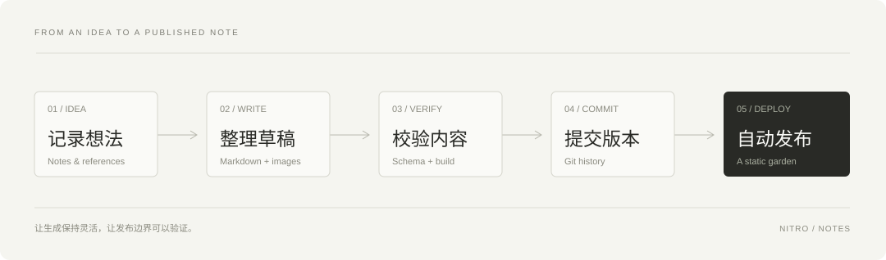

> 这是一篇用于展示博客排版与内容组织的示例文章，可直接替换为你的真实实践记录。

一个能回答问题的模型，和一个能完成工作的系统，中间隔着很多具体的工程决策。工具怎么调用，信息如何保存，错误由谁发现，结果又如何验收？这些问题，比给 Agent 起一个名字更值得讨论。

## 从一个具体任务开始

假设我们要让 AI 协助维护技术博客。目标可以很明确：把一份笔记整理成文章，补上必要的插图，通过校验后发布。

如果只提供一句「帮我写篇博客」，模型很难知道什么才算完成。我们需要把目标转换成可以检查的产物：

- 文章正文存放在 `content/posts/<slug>/index.md`。
- 图片位于同篇文章的 `images/` 子目录。
- 分类和标签登记在 `content/meta.json`。
- 草稿经过人工阅读，构建和链接检查通过。

当输入、输出和边界都明确时，工作流才具备可重复性。

## 给工作流一个清晰的结构

不必从复杂的多智能体系统开始。一个顺序执行的流程，往往已经足够：



这里最关键的连接点是**校验**。生成文章是模型擅长的事，检查文件是否存在、分类是否有效、构建能否成功，则更适合确定性的程序。

```typescript
type Stage = 'draft' | 'review' | 'validated' | 'published';

interface WritingTask {
  slug: string;
  stage: Stage;
  acceptance: string[];
}

const task: WritingTask = {
  slug: 'building-with-agents',
  stage: 'draft',
  acceptance: ['图片可访问', '元数据合法', '构建成功'],
};
```

### 不确定的生成，确定的边界

模型可以尝试不同的标题和论述方式，但不能随意创造分类，也不能把缺失的图片当成已经存在。把这些约束放进代码校验，能减少反复沟通。

### 把完成标准写成可观察的信号

「文章已经好了」是一个模糊的判断。「类型检查通过，静态站点构建成功，草稿标记已移除」则可以被工具验证。

## 上下文需要被维护

把所有历史都放进提示词，并不等于提供了有效上下文。更实用的做法，是按任务提供所需材料：

| 材料 | 作用 | 保存位置 |
| --- | --- | --- |
| 项目规则 | 规定内容与交付约束 | `AGENTS.md` |
| 文章元数据 | 管理分类、标签和精选 | `content/meta.json` |
| 本次写作材料 | 支撑正文论述 | 当前文章目录 |
| 验证结果 | 判断是否能发布 | 命令输出与构建产物 |

上下文的价值，来自它与当前决策的相关性。一个清晰的目录结构，也是一种上下文设计。

## 在自动化之前建立反馈

先手动跑通一次完整流程，再逐步自动化其中稳定的部分。观察哪里最容易出错，再决定增加什么规则。

可以先记录三个问题：

1. 哪一步需要最多人工修改？
2. 哪些错误每次都能被相同的检查发现？
3. 哪些判断始终需要作者自己完成？

前两项适合沉淀为工具，第三项应该保留清晰的人工决策入口。

## 把工作流当作作品的一部分

好的 Agent 工作流，应该让下一次工作更容易开始。它留下的不只是文章，还有可以继续使用的结构、约束和经验。

下一次迭代可以很小：补一条图片检查，改一个元数据字段，或者把一个经常失败的步骤拆得更清楚。从这样的细节开始，自动化才会慢慢变得可靠。
