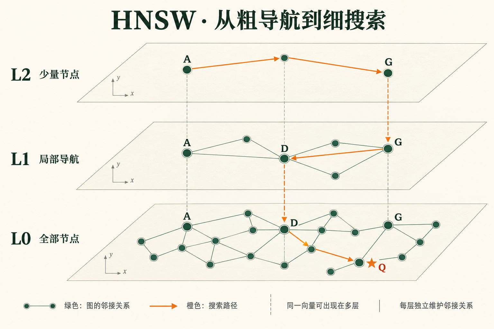
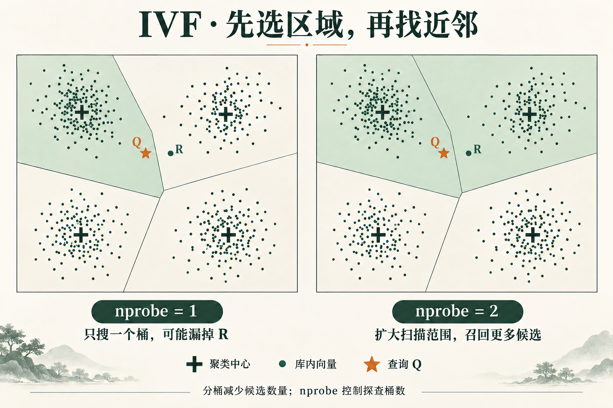
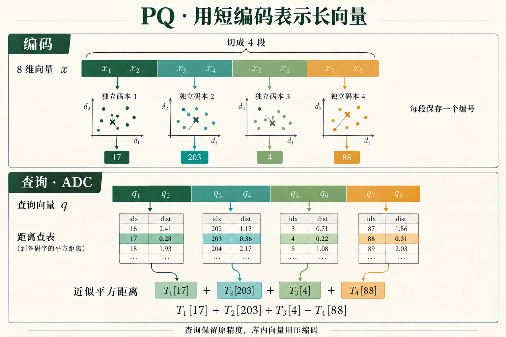

RAG 文档更新时，为什么可以“小批量实时 upsert，大批量离线重建索引”？先分清三个东西：**原文、向量、索引**。

复习顺序：先看“30 秒回答”，再读三张原理图；算法全景、场景和真实应用集中在第 5 节，更新与重建按需回看。

## 30 秒回答

> 向量索引是为相似度检索组织向量的数据结构。Embedding 模型把文本变成向量，索引帮助我们快速找到相近的向量。全量扫描精确但成本高，ANN（近似最近邻）通过缩小搜索范围或压缩向量，换取速度与空间收益，代价是可能漏掉真正的近邻。索引可由已有向量重新构建；只有内容或 Embedding 方案变化时，才需要重新生成相应向量。

## 1. 索引到底索引了什么？

```text
文档 → 切成 chunk → Embedding → 向量 + chunk_id + 元数据
                                  ↓ 构建索引
问题 → 同一套 Embedding → 查询向量 → 检索 top-k → 取回原文
```

- **原文**保存知识；**向量**是模型生成的数值表示；**索引**组织这些向量，减少检索开销。
- **向量数据库**还负责持久化、元数据过滤、并发和数据更新等，索引只是其中一部分。
- “相近”由度量决定：余弦比较方向，内积同时受向量长度影响，L2 衡量欧氏距离。查询和库内向量都归一化后，内积等于余弦相似度，L2 排序也等价。见 [Faiss 距离说明](https://github.com/facebookresearch/faiss/wiki/MetricType-and-distances)。

没有加速结构时，可逐个计算查询与库内向量的距离：N 条 d 维向量约需 O(Nd) 的计算。Flat 就是常见的全量扫描基线；**叫“索引”的实现也可能是精确扫描，并非所有向量索引都是 ANN**。

## 2. HNSW：为什么分层？每层都要建图吗？

先从最简单的近邻图想起：每个向量是一个点，给它连上若干近邻；查询时沿着“更接近目标”的边走。问题是：只有局部短边，远距离查询可能要走很多步。

**小世界图加入跨区域的连接；HNSW 再用层级把粗定位与细搜索分开。** 上层点少，连接往往跨得更远；底层点全，负责找细节。这里的“远近”仍是同一种向量距离。



*绿色连线表示各层邻接关系，橙色箭头表示一条简化搜索路径；层间虚线连接同一节点。配图为 AI 生成的教学示意，平面间距不代表新的向量维度。*

### 点跨层出现，但空间位置不变

- 每个点随机得到一个最高层号，越高越少；若最高层是 L2，它会同时出现在 L0、L1、L2。
- 跨层的是**同一个 ID、同一个向量**，不是重新 Embedding，也不是把向量按不同语义投影到不同层。
- **节点集合嵌套，边集合不必嵌套。** 上层只保留少量点，要在这些点之间重新选择邻接关系，不能简单删除底层的其他点与边就得到可用上层。

### 插入和查询分别怎么走？

**插入：** 随机抽最高层 → 从入口在高层导航 → 在新点参与的各层搜索候选、选择邻居并连接，必要时裁剪边。各层都维护自己的邻接表，但会利用已有图寻找候选，**不需要每次全量两两比较**。

**查询：** 先在上层贪心靠近 Q，将找到的点作为下一层入口；到底层后，用候选集合继续探索，返回 top-k。图里的橙线是简化路径，实际底层会保留多个候选，不是只沿单一路径前进。

这是 [HNSW 原论文](https://arxiv.org/abs/1603.09320) 的层级与增量建图思路；[hnswlib](https://github.com/nmslib/hnswlib) 提供具体实现。

| 参数 | 决定什么 | 增大后的常见代价 |
| --- | --- | --- |
| `M` | 图的连接规模 | 图更大，构建与搜索工作可能增加 |
| `efConstruction` | 插入时探索多少候选 | 构建更慢，通常有利于图质量 |
| `efSearch` | 查询时探索多少候选 | 召回通常提高，延迟增加 |

**适合：** 低延迟、高召回的在线 RAG、语义搜索、推荐召回，且内存预算足够。**注意：HNSW 仍是近似检索，不承诺精确 top-k；更新、删除能力还取决于实现。** 参数说明见 [hnswlib 调参文档](https://github.com/nmslib/hnswlib/blob/master/ALGO_PARAMS.md)。

## 3. IVF：先分桶，再搜部分桶

IVF（Inverted File）先对训练样本做聚类，得到 `nlist` 个中心，把每条向量放入最近中心对应的列表。查询时找最近的 `nprobe` 个中心，再搜索这些列表。



*十字表示聚类中心，浅绿区域表示被扫描的桶。左侧只选一个桶，右侧选两个；分区边界与点位为 AI 生成的概念示意，不是实际聚类结果。*

例如一百万条向量分成一千桶，若桶大小均匀，每次探查十桶，大约扫描一万条，另加选桶成本。这只是**数量估算，不是性能实测**；分布不均时，热门大桶会改变开销。

- **IVF-Flat**：桶里保留原始向量。桶内距离算得精确，但未扫描的桶里可能有更近的点，所以全局仍是 ANN。
- **`nprobe` 越大**：扫描范围通常越大，召回越高、查询越慢。IVF-Flat 探查全部桶时，在不额外截断候选的前提下，可退化为精确扫描。
- **`nlist` 不是越大越好**：桶多会增加中心搜索和训练成本；固定 `nprobe` 时，覆盖的数据范围也可能减少。
- 数据分布明显变化时，要评估是否重新训练中心；普通新增可直接分配到已有桶，不必每写一条就重新聚类。

**适合：** 大规模检索、批量处理、GPU 加速，以及希望灵活控制扫描预算的场景。**IVF-Flat 并不压缩原始向量，省内存通常还需组合 PQ / SQ。** 原理与变体见 [Faiss 索引说明](https://github.com/facebookresearch/faiss/wiki/Faiss-indexes)。

## 4. PQ：压缩的不是条数，而是每条向量

PQ（Product Quantization，乘积量化）把 d 维向量切成 m 段，每段独立训练一个小码本；存储时只保存每段最近码本中心的编号。



*上半图说明四段子向量如何编码为 `[17, 203, 4, 88]`；下半图用这些编号查表求和。AI 生成配图中的码本点集与距离数值仅用于演示。*

例如 768 维 float32 原向量占 `768 × 4 = 3072 B`；切成 96 段，每段 8 维，各用 256 个中心，则每段编号只需 8 bit，整条编码 `96 B`，**编码负载约缩小 32 倍**。这不包含共享码本、ID、图边、元数据或另存的原始向量。

**为什么查表能算距离？** 以平方 L2 为例，各段距离可以相加。查询 q 先计算每段到各码本中心的距离，得到表 T；扫描一条编码时，按编号取值求和，估计 q 到该向量的距离。查询侧保留原精度、库内使用压缩码，称为 **ADC（非对称距离计算）**。

**PQ 不负责决定搜索哪些点。** 单独 PQ 可以扫描所有编码，仍因距离近似而产生排序误差；IVF-PQ 则先选桶，再计算压缩距离。Faiss 的 IVF-PQ 通常还会编码相对于桶中心的残差，而非直接编码原向量。见 [PQ 原论文](https://hal.inria.fr/inria-00514462/document)及 [Faiss 实现说明](https://github.com/facebookresearch/faiss/wiki/Implementation-notes)。

**适合：** 内存受限的大规模图像、商品、文档向量库。常用“多取候选 + 原始向量重算距离”恢复排序质量；但**重算只能纠正已召回候选，找不回漏掉的点**。

## 5. 索引优化算法全景：按路线记，不按产品名背

下面覆盖面试常见的主要路线与代表变体，不穷举每篇论文。**候选组织、向量压缩、计算加速可以组合**，因此 HNSW、IVF、PQ 不是三个互斥选项。

| 路线与代表 | 如何优化 | 常见使用场景 / 主要限制 |
| --- | --- | --- |
| 精确扫描：Flat | SIMD、矩阵乘法、GPU 批量算距离 | 小候选集、离线精确基线；总扫描量随 N 增长 |
| 空间树：KD-tree、Ball-tree | 利用空间边界剪枝 | 低维坐标、结构化特征；高维可能剪不动，趋近扫描 |
| 随机投影树：Annoy | 多棵树切分空间，合并叶节点候选 | 静态推荐向量、文件共享加载；索引构建后通常重建更新 |
| 哈希：LSH、SimHash、MinHash | 让相似对象更可能碰撞到同一桶或相近签名 | 去重、特定相似度检索；SimHash 偏角度，MinHash 对应集合 Jaccard，不能混用 |
| 分桶：IVF、IMI | 聚类或子空间组合成大量桶，只访问部分 | 大规模向量召回；受分桶质量、桶倾斜和探查预算影响 |
| 内存图：NSW、HNSW、NSG | 沿近邻边导航；分层或剪边改善连通与路径 | 在线低延迟召回；额外图内存与建图成本 |
| 磁盘图：DiskANN / Vamana | 图导航结合 SSD、缓存与压缩表示 | 数据超出内存预算；要控制随机 I/O 和尾延迟 |
| 标量 / 低比特量化：SQ、二值量化、RaBitQ | 减少每维的编码位数，便于 SIMD 与位运算 | 省内存、加快距离计算；误差与估计方式依算法而异 |
| 子空间量化：PQ、OPQ | PQ 分段编码；OPQ 先学习变换改善可压缩性 | 大库压缩；训练、查询变换与精度之间需权衡 |
| 加性量化：AQ、RQ、LSQ | 多个码字相加逼近向量；RQ 逐级编码剩余误差 | 更灵活的压缩表示；训练、编码与距离计算更复杂 |
| 组合系统：ScaNN / SOAR | 分区、量化评分、重排；SOAR 增加有选择的冗余分配 | 大规模内积 / 向量召回；需要共同调节多个阶段 |
| GPU 图：CAGRA | 为 GPU 并行设计建图、剪边与图搜索 | GPU 上高吞吐检索、加速构建；受显存和传输成本约束 |

实现依据：[空间树](https://scikit-learn.org/stable/modules/neighbors.html)、[Annoy](https://github.com/spotify/annoy)、[Faiss 编码与组合](https://github.com/facebookresearch/faiss/wiki/The-index-factory)、[加性量化](https://github.com/facebookresearch/faiss/wiki/Additive-quantizers)、[DiskANN](https://www.microsoft.com/en-us/research/publication/diskann-fast-accurate-billion-point-nearest-neighbor-search-on-a-single-node/)、[ScaNN](https://research.google/blog/announcing-scann-efficient-vector-similarity-search/)、[CAGRA](https://docs.nvidia.com/cuvs/user-guide/api-guides/indexing-guide/cagra)。

**还有两层优化别漏掉：** PCA / 模型支持的降维减少 d；SIMD、PQ FastScan、GPU、批处理减少每次计算成本。降维可能损失信息，GPU 也不等于 ANN。前置过滤、过滤感知遍历和必要时对过滤结果精确扫描，则决定了“在什么候选范围里找”。

### 选型速查：先说约束，再说算法

| 约束 / 场景 | 优先评测的方案 |
| --- | --- |
| 必须精确 top-k，或过滤后只剩少量记录 | Flat / GPU Flat；低维可试空间树 |
| 在线 RAG，低延迟、高召回、内存充足 | HNSW；内存吃紧再评测量化组合 |
| 大规模商品 / 图片库，内存有限 | IVF-PQ / OPQ，或 DiskANN；比较总成本与召回 |
| GPU 常驻、大量查询或离线批处理 | GPU Flat、IVF-Flat、IVF-PQ、CAGRA |
| 静态向量文件，要多个进程共享加载 | Annoy；接受更新时重新构建 |
| 文档近重复检测 | 与特征相似度匹配的 SimHash / MinHash + LSH |

这些是评测起点，不能当固定最佳答案。尤其不能概括成“数据大且要求精确就 HNSW，不太精确就 IVF”：**两者都能调节召回与成本；HNSW 不保证精确，IVF 也能做到高召回。** IVF 的低内存优势往往来自压缩组合，实际取舍要在相同召回目标下比较。

### 真实应用：记住它解决了什么约束

| 已公开的应用 | 使用方式与启示 |
| --- | --- |
| **Spotify：Annoy → Voyager（2023）** | Annoy 曾用于音乐推荐；Spotify 后发布基于 hnswlib 的 Voyager，作为生产使用的推荐替代库。说明静态树与 HNSW 的取舍会随需求演进。[工程博客](https://engineering.atspotify.com/2023/10/introducing-voyager-spotifys-new-nearest-neighbor-search-library) |
| **Pinterest：广告召回（2025）** | 团队披露从 HNSW 迁到 IVF，以支持更大的广告索引，并在查询上下文较静态的场景采用离线 ANN、在线 KV 查结果。成本优化也可以来自查询架构。[工程博客](https://medium.com/pinterest-engineering/unlocking-efficient-ad-retrieval-offline-approximate-nearest-neighbors-in-pinterest-ads-6fccc131ac14) |
| **Microsoft：Bing、Microsoft 365** | 微软公开说明 DiskANN 用于这些服务，体现 SSD 图检索在大规模搜索中的价值。[官方说明](https://techcommunity.microsoft.com/blog/adforpostgresql/introducing-diskann-vector-index-in-azure-database-for-postgresql/4261192) |
| **Google Cloud：Vertex AI Vector Search、AlloyDB（2024 披露）** | Google 说明这些产品使用 ScaNN 技术；SOAR 则通过有选择的冗余分桶改善召回与开销。[Google Research](https://research.google/blog/soar-new-algorithms-for-even-faster-vector-search-with-scann/) |
| **Elasticsearch：向量检索产品实现** | 支持 HNSW 与量化组合，并可多取候选、用原始向量重算。它证明“图 + 压缩 + 重排”可组合；具体类型依版本而异。[官方文档](https://www.elastic.co/docs/solutions/search/vector/knn/optimize-performance-accuracy) |
| **Google：网页近重复检测（2007 论文）** | 作者用 SimHash 研究多十亿网页库中的近重复识别。这是相似性哈希的真实应用背景，不能直接等同于今天的稠密 Embedding 语义召回。[原论文](https://archives.iw3c2.org/www2007/papers/paper215.pdf) |

补充一个**公开基准，而非生产案例**：Meta 在 Faiss 的十亿向量评测中使用 `OPQ20_80,IMI2x14,PQ20`，直观展示“变换 + 分桶 + 压缩”的组合；不能据此声称某条生产推荐链路就采用相同配置。[Meta 评测说明](https://engineering.fb.com/2017/03/29/data-infrastructure/faiss-a-library-for-efficient-similarity-search/)

## 6. 为什么能批量重建？

因为索引是从向量构造出的结构。**只要保留了所需向量与 ID 等信息，就能重新建图、分桶或编码，不必再调用 Embedding 模型。** 如果只剩有损压缩码，不能假定能恢复原始向量。

| 变更 | 重新 Embedding？ | 索引怎么处理？ |
| --- | --- | --- |
| 调整 `efSearch` / `nprobe` | 不需要 | 通常无需重建 |
| HNSW 换 IVF，或调整结构参数 | 不需要，前提是原向量可用 | 重建相应索引 |
| 修改文档正文 | 对变更的 chunk 需要 | 写入新向量，清理失效记录 |
| 更换 Embedding 模型或向量预处理方案 | 通常要对全库重新生成 | 重建，并同步查询侧方案 |

**同维度不代表同一向量空间。** 换模型后，不能直接把新查询向量与旧库向量混用。

“重建分区索引”表示只处理相应数据范围，但数据库实际可能按 segment 等单元建索引；是否支持、如何触发，要看具体产品。**大批量不等于必须手动重建**，也可能批量导入后由数据库自动构建。

## 7. 小批量更新与大批量重建怎么做？

### 小批量：增量更新

假设文档 D 的 v1 有 5 个 chunk，v2 只有 3 个。只 upsert 新的 3 条记录，旧版第 4、5 条可能仍被检索到。

因此要记录 `doc_id`、`version`、`chunk_id`，处理**整个文档版本的替换**，而非只覆盖同名 chunk。可先写入并验证 v2，通过事务或应用层的版本过滤切换可见版本，再删除 `doc_id=D AND version=v1`。是否能原子切换取决于系统能力；删除时不能误删新版本。

upsert 是逻辑上的“存在则更新，不存在则插入”；底层可能用删除标记加新写入实现，写入确认与查询可见也未必同时发生。

### 大批量：旁路构建，再切换

```text
确定数据快照 → 构建新集合及索引 → 补齐期间增量
            → 校验数据与检索效果 → 切换查询入口 → 保留旧版供回滚
```

这是一种工程方案：让旧集合继续服务，新集合准备好后再接流量。Milvus 的 [集合别名](https://milvus.io/docs/manage-aliases.md) 支持将稳定名称重新指向新集合。

注意：别名切换解决的是入口指向，**不会自动补齐构建期间的新增、修改和删除**。需要变更日志回放、双写或短暂冻结写入等配套；更换模型时，还要让查询 Embedding 与目标集合一起切换。

## 8. 面试最后记住这 5 问

**怎么选索引？** 先用 Flat 建立精确基线；再按数据规模、内存、延迟、召回率和更新频率评测 HNSW、IVF 或压缩方案，不背固定数量阈值。

**怎么判断 ANN 效果？** 对同一批查询，用精确 top-k 作基准：`Recall@k = 近似结果与精确结果的交集数量 / k`，再取查询平均。同时看 P95 延迟、内存和构建时间。ANN 召回高不代表 RAG 答案必然正确，Embedding、切分和后续排序也影响效果。

**为什么查得快却召回差？** 可能搜索预算太小、压缩误差大，或过滤策略限制了候选。先区分索引漏召回与向量本身没有表达好语义。

**重建等于重新向量化吗？** 不等于。**重新向量化改变表示，重建索引改变检索组织方式；文档更新还要解决版本一致性。**

**HNSW、IVF、PQ 最关键的区别？** HNSW 沿图找候选，IVF 按桶筛候选，PQ 压缩表示并近似算距离；前两者主要减少“查多少”，PQ 主要减少“每条多大、怎么算”。
